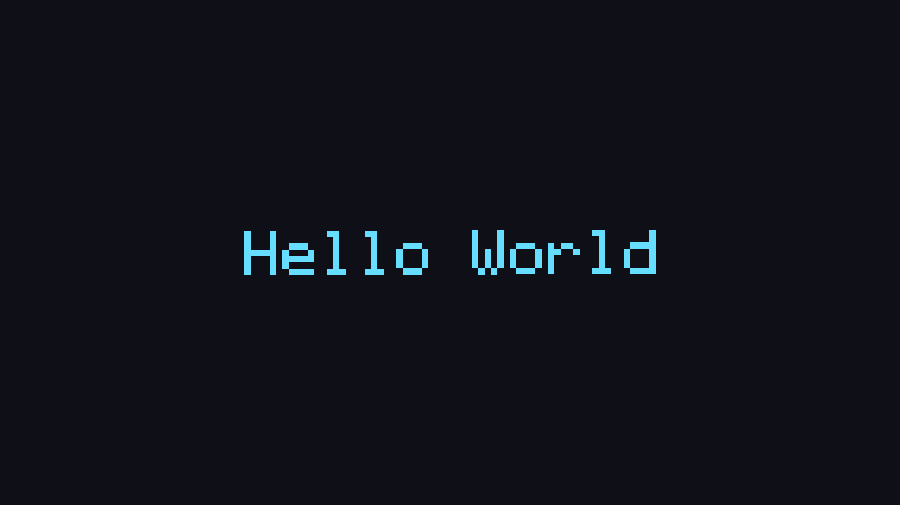
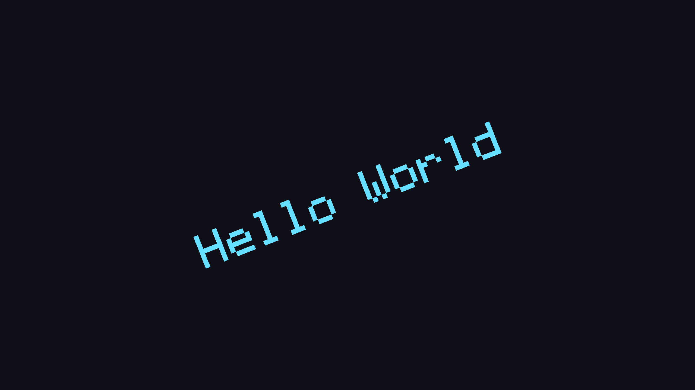

# HW1 - OpenGL Project

## 实验内容

使用 C++、OpenGL 和 GLFW 创建图形窗口，实现 Hello World
文字绘制，并通过透视投影和坐标变换实现文字绕 Z 轴的三维旋转动画。

## 实验环境

- 操作系统：macOS
- 编程语言：C++
- 图形接口：OpenGL
- 窗口管理：GLFW
- 构建工具：CMake

## 编译与运行

```bash
cmake -S . -B build
cmake --build build
./build/OpenGLProject
```

## 实验结果

文字正面：



文字旋转：

